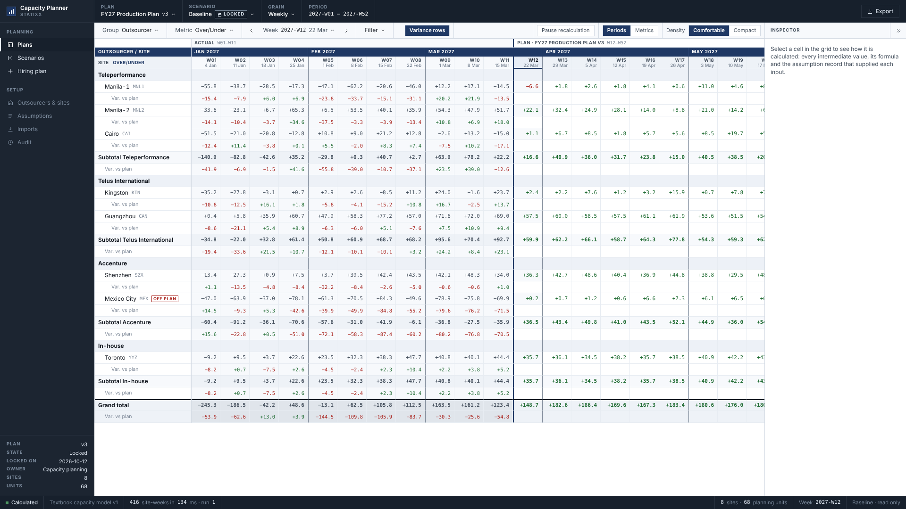
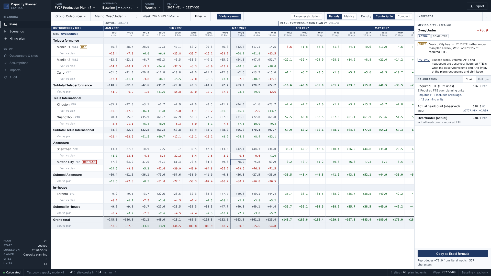
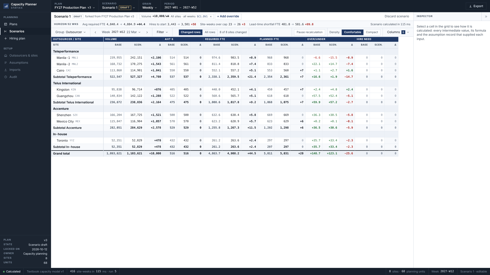
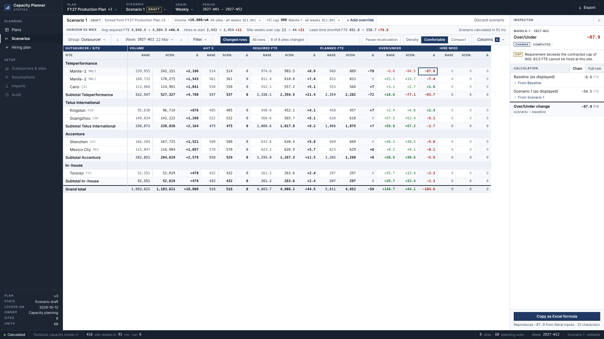
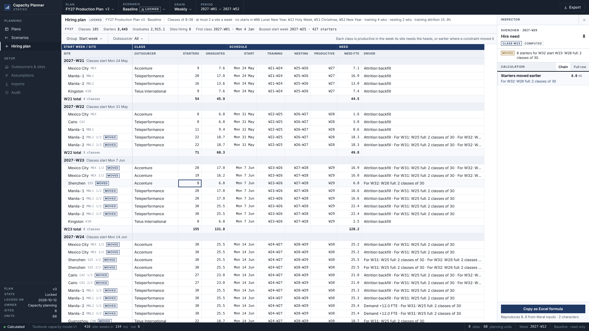
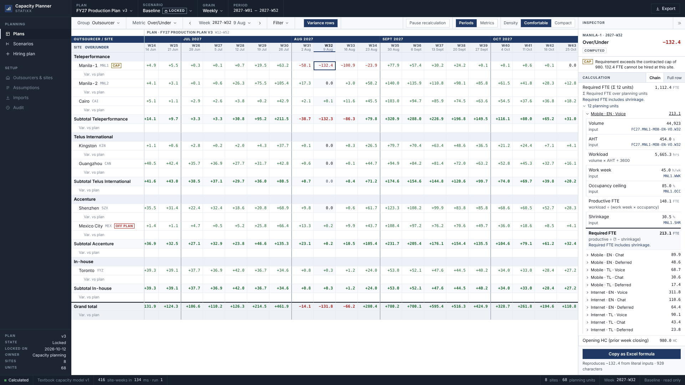
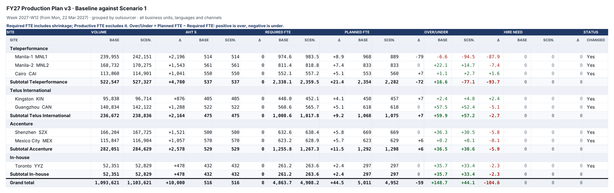

# WFM Capacity Planner (mvp demo)

Multi-outsourcer contact centre capacity planning. Takes a weekly demand
forecast and produces Required FTE per site, the Over/Under against planned
supply after attrition and ramp, and the recruitment instruction: how many to
hire, where, starting which week.

**Terminology** follows the incumbent WFM tools. **Productive FTE** is the
on-phone requirement before shrinkage. **Required FTE** includes shrinkage: it
is the number a planner budgets and hires to. **Planned FTE** is the headcount
the plan expects to have. **Over/Under** = Planned FTE − Required FTE: positive
is over (a surplus), negative is under (a deficit). See CHANGELOG.md for the v2
renames.

Statixx Solutions. All data in this repository is invented.

**Click-through demo:** https://isaacxj.github.io/wfm-demo/ (desktop browser,
1600px wide or more)



## Build status

| Phase | Scope | Status |
|---|---|---|
| 1 | Calculation engine and seeded dataset | Done |
| 2 | Plan grid | Done |
| 3 | Calculation inspector | Done |
| 4 | Scenario comparison | Done |
| 5 | Hiring plan view | Done |
| 6 | Excel export | Done |
| 7 | Deploy | GitHub Pages, on every push to `main` |
| v2.1 | Terminology: industry names, Over/Under sign, shrinkage convention | Done |
| v2.2 | Grid orientation: Periods and Metrics modes; density | Done |
| v2.3 | Actuals, plan and scenario bands | Done |
| v2.4 | Pause recalculation; class constraints | Done |
| v2.5 | Bulk entry; Staff Type | Not started |
| v2.6 | Driver and event register | Not started |
| v2.7 | Budget variance; report view | Not started |

## Demo walkthrough

Eight steps: the demo script, plus actuals. Everything runs in the browser on an
invented 2027 dataset: 8 sites, 4 outsourcers, 68 planning units, 52 weeks.

### 1. Open the locked production plan and read the grid

The app opens on **FY27 Production Plan v3**, scenario **Baseline**, marked
**LOCKED**, in **Periods** mode: one column per week of 2027 under month bands,
rows for each outsourcer, its sites, a subtotal, then the grand total, and
**Over/Under** in every cell. Weeks W01 to W11 have elapsed and show actuals,
shaded; from W12 the grid shows the locked plan. A **Var. vs plan** row under
each row gives actual − plan. Read the whole year for every site in one pass:
Manila-1 runs under in the marketing-spike weeks W31 to W34. **Metric** switches
the number shown. **Metrics** (top right) turns the grid round to one week with
columns running demand → requirement → supply → over/under and hiring. Step through weeks with ‹ ›; filter by business unit,
language and channel; regroup by country. Subtotals add the displayed site values exactly.
Faint left markers show the input cells a planner may change. Manila-1 carries
a **CAP** flag whenever its headcount sits at its contracted cap of 980.

### 2. Spot the site that has drifted

Mexico City carries an **OFF PLAN** flag, and its variance row runs red from
W04. It took more contacts than forecast, they ran longer, and attrition ran
ahead of plan: over W08 to W11 it averaged 70.7 FTE further under than
planned, 11.2% of its requirement. Every other site is within a few percent
either way. Select its actual Over/Under in W09 (−78.9): the inspector says
the week is observed, names the drift, and traces the number to the actuals
records (`ACT27.MEX.HC.W09` for headcount).



### 3. Move AHT by 5 percent

Open **Scenarios** → **Fork scenario from v3** → **+ Add override** → **AHT**,
+5, all sites, all weeks → **Apply**. Every metric now shows baseline,
scenario and change side by side. In 2027-W12, Required FTE rises by
**+243.1**. Over the year, hires to start rise from 3,443 to 3,804. The baseline
stays locked; the scenario is a separate, fully recalculated plan.


### 4. Add 10,000 contacts a week and compare side by side

Remove the AHT override (× on its chip), then **+ Add override** → **Volume**,
+10,000 contacts / week → **Apply**. The grand total volume change is exactly
**+10,000**, split across planning units by their share of each week's volume.
Required FTE moves **+44.5** in W12. "Changed rows" / "All rows" toggles the
unchanged sites. The strip above the grid summarises the whole year.



### 5. Cut Manila-1 below its requirement

**+ Add override** → **HC cap** → Manila-1 → **900** → **Apply**. Manila-1's
Planned FTE drops to 889, under the cap (W12's class would have started in W06,
which is blocked for Lunar New Year), and its Over/Under falls by **−87.9**.
Selecting the change cell shows the cap note in the inspector: requirement
exceeds the cap, and 83.5 FTE cannot be hired at this site.

To stage several edits, **Pause recalculation** first (toolbar, right). Edits
then wait: their chips are marked STAGED, the grid greys out, and the status
bar counts the pending changes. **Resume** recalculates once with all of them;
the status bar's run counter goes up by one.



### 6. Read the hiring plan

**Hiring plan** in the rail. This is the recruitment instruction: for each start
week, which site hires how many, training and nesting weeks, the week the class
is productive, and why. 185 classes and 3,443 starters across the year; the
busiest start week is 2027-W25, 427 starters ahead of the marketing spike.
Classes hold 8 to 30, a site starts at most two a week, and no class starts in
a blocked week (W06 Lunar New Year, W12 Holy Week, W51 Christmas, W52 New
Year). Where the ideal week is blocked or full, the class starts earlier,
never later, flagged **MOVED** with its reason: Kingston's W18 class starts in
W11 because W12 is Holy Week, and the W31 spike hiring spreads back over W22
to W24 because W25 is full. Underneath: every class moved earlier and why, then
needs hiring cannot meet: deficits inside the six-week lead time, demand above
a contracted cap, and Manila-1's W12 need, whose start week is blocked with no
earlier week having room under its cap.



### 7. Trace any number

Select any cell. The inspector shows the chain behind it: every intermediate
value, its formula, and the assumption code of each input. Totals open into
their planning units, and opening headcount into the prior week.
**Copy as Excel formula** copies a formula that reproduces the value. Shown:
Manila-1's Over/Under in 2027-W32: −132.4 FTE, the demand above its cap.



### 8. Export to Excel

**Export** (top right) saves the current view as .xlsx, keeping its structure:
merged column-group bands, collapsible outsourcer groups, live SUBTOTAL formulas
and change formulas. Shown: the comparison from step 5, rendered from the
exported file.



Scenarios are kept in the browser's local storage. **Discard scenario**
returns to a clean start.

## Commands

Node 22.18 or later.

```bash
npm install
npm run dev        # local app
npm run build      # typecheck and static build to dist/
npm test           # engine reference cases, dataset and grid checks
npm run typecheck
npm run totals     # prints dataset totals and the week 12 snapshot
```

## Layout

```
src/engine/   calculation engine; the UI imports src/engine/index.ts only
  requirement.ts  period requirement, channel handling
  erlang.ts       interval staffing, Erlang C with occupancy ceiling
  supply.ts       attrition, roll-forward and hiring primitives
  siteweek.ts     site-week roll-forward with the recommended class fed back
  plan.ts         unit → site → week plan computation
  actual.ts       observed weeks: the requirement actuals imply, against actual headcount
  slice.ts        filtered slice of a site-week, supply allocated by share
  trace.ts        calculation trace with Excel equivalents
  calendar.ts     ISO week arithmetic
src/app/      application shell, plan grid, row model and calculation inspector
src/scenario/ scenarios: overrides applied to a locked plan's inputs
src/export/   .xlsx export of plans, comparisons and the hiring plan
src/testing/  test helpers, never imported by the app
src/data/     seeded demo dataset, 8 sites, 4 outsourcers, 68 planning units, 52 weeks of 2027,
              and actuals for weeks 1 to 11
scripts/      totals.ts
```

## Engine

A textbook capacity model behind the `CapacityEngine` interface in
`src/engine/index.ts`. A replacement engine implements the same interface.

- Requirement: workload = volume × AHT ÷ 3600; productive FTE = workload ÷ (work week × occupancy); required FTE = productive FTE ÷ (1 − shrinkage). Required FTE includes shrinkage
- Over/Under = planned FTE − required FTE; positive is over, negative is under
- Chat: effective AHT = AHT ÷ (concurrency × efficiency). Deferred work applies no occupancy ceiling
- Interval: Erlang C, always floored at ceil(traffic ÷ occupancy ceiling)
- Supply: weekly attrition = 1 − (1 − monthly)^(1 ÷ 4.33); a contracted cap limits productive hires and surfaces demand above it as a cap shortfall
- Hiring: starters = ceil(deficit ÷ (1 − training attrition)), starting training + nesting weeks before the need. The recommended class lands in supply, so a persisting deficit is hired for once
- Minimum class size: a recommended class has at least 8 starters, rounded up from the need where room under any cap allows; the extra graduates carry forward as a small surplus
- Class constraints: at most 30 a class and 2 classes a site a week; no starts in blocked weeks. Starters the ideal week cannot take start in the latest earlier week with room, sized for attrition between landing and the week they are for. Their graduates land early and are held for that week: in supply, but not counted against the deficits of the weeks between, so the early class adds cover rather than replacing those weeks' own classes. The site then rolls forward again from the week they land. Starters no week can take stay as a shortfall
- Committed pipeline: classes already in training at plan start land in weeks 1 to 6; inside that lead time no new class can land, and any deficit remains as a lead-time shortfall
- Filters: demand sums over the matching planning units; site supply is allocated to the slice by its share of required FTE
- Actuals: required FTE from observed volume and AHT by the same requirement arithmetic; Over/Under = observed headcount − that requirement; a filtered slice gets observed headcount by its share of required FTE

Every result carries an ordered trace: label, value, unit, formula, the
assumption record code of each input, and an Excel formula that reproduces the
value from literal inputs. Each computed step lists the steps it was computed
from, and roll-ups carry their sub-chains: a site's demand carries each
planning unit's trace, a week's opening headcount carries the prior week's.

## Plan grid

Two orientations, chosen top right and remembered for the session.
**Periods** (default) puts weeks across the columns, months as bands with a
heavier rule at each month start, each week labelled by ISO week over its
Monday date, and one metric in the cells: Volume, AHT, Productive FTE,
Required FTE, Planned FTE, Over/Under or Hire need. **Metrics** shows one week
with every metric across the columns. Both use the same rows, filters and
grouping; the selected cell carries across, and clicking a week column moves
the focus week. **Density** switches between comfortable 25px rows and compact
21px rows. Export saves whichever orientation is on screen.

In Periods mode the weeks fall in three bands, named in a strip above the
months and divided by an accent rule. **Actual**: weeks already elapsed (W01
to W11, since the plan lands on W12), shaded, in grey numerals. **Plan**: the
remaining weeks of the locked plan, white. **Scenario**: with a scenario open,
the remaining weeks show it instead, tinted. A **Var. vs plan** row under each
row (toggle: **Variance rows**) gives actual − plan in elapsed weeks and
scenario − plan after them. Variance is coloured by what it does to
Over/Under: green moves the site towards over (fewer contacts, shorter
handling, more heads), red towards under. A site whose Over/Under variance
over the last four elapsed weeks averages 5% of its requirement or more is
flagged **OFF PLAN**. Metrics mode shows plan figures for every week, and says
so on an elapsed week.

Actuals are data, not engine output: observed volume and AHT per planning unit
and headcount per site, from the actuals feed (record codes `ACT27.…`). The
engine works out the requirement they imply with the plan's own arithmetic,
at the plan's occupancy and shrinkage, so actual and plan compare like for
like: actual Over/Under = actual headcount − that requirement. Actual weeks
carry no hire need. The plan is not re-forecast from actuals: from W12 it is
the plan as locked. The demo's actuals are seeded: the plan moved a few
percent either way per site and unit, with Mexico City drifted.

Opens on the locked FY27 production plan at week 2027-W12. Rows are an
outsourcer header, its sites and a subtotal, then a grand total; grouping switches to
country or none. The toolbar filters by week, business unit, language and
channel. Under a filter, demand covers only the matching planning units and
site supply is split by share of required FTE; the supply band says so.

Subtotals add the site values as displayed, so every summed column reconciles
digit for digit on screen. Input cells carry a left marker; computed cells do
not.

## Calculation inspector

Selecting any cell shows how it was calculated, in the panel on the right:
every intermediate value with its formula, and the assumption record code of
each input. The default view is the chain behind the selected number; "Full
row" shows the whole site-week. Site roll-ups expand into their planning units,
opening headcount into the prior week, subtotals into their sites, and filtered
slices into the site they were split from.

"Copy as Excel formula" puts a self-contained formula on the clipboard that
reproduces the selected value from literal inputs. Every Required FTE step,
and every selected Required FTE cell, states "Required FTE includes
shrinkage." A site above its contracted
cap, a deficit inside the training lead time, and a filtered split are called
out above the chain. The panel collapses to a narrow strip and remembers its
state; selecting a cell opens it, Escape clears the selection.

## Scenarios

The FY27 production plan is locked. A scenario forks from it and overrides
inputs: weekly volume (contacts per week or a percentage, for a range of weeks),
AHT, shrinkage, monthly attrition, or a site's contracted headcount cap, each
scoped to all sites, an outsourcer or one site. Added contacts are split across the
planning units in scope by their share of each week's volume. The baseline is
never edited; the scenario is a second plan the engine computes in full, and
each overridden input carries the override's code (for example `SC1.OV2`) in
its assumption record.

The Scenarios view compares the two in one grid: per metric, baseline,
scenario and change. It shows changed rows by default, with a toggle for all
rows, and a horizon strip above it: average required FTE, hires to start,
site-weeks over cap and lead-time shortfall, baseline against scenario. A
scenario recalculates in well under a second. Selecting a change cell traces
it as scenario minus baseline, each side opening into its own chain.
Scenarios are kept in the browser's local storage.

**Pause recalculation** (toolbar) holds the scenario as last calculated. Edits
made while paused are staged: override chips are marked STAGED (or REMOVAL
STAGED), every grid number greys to show it predates them, and the status bar
reads "Recalculation paused · N pending changes", counting each edit. **Resume**
recalculates once with all of them. The status bar's run counter numbers each
calculation since the page opened, so a resume after four edits shows one
more run, not four.

## Hiring plan

The recruitment instruction for the open plan or scenario: how many to hire, at
which site, starting which week. Classes are grouped by start week (or by site),
each with its outsourcer, starters, expected graduates after training attrition, the
training and nesting weeks, the week its graduates are productive, the deficit
it closes and what drives it. A summary line gives classes, starters, graduates,
the first class and the busiest start week. The header states the class
constraints: class size, classes a site can start in a week, and blocked weeks.
A site's starters in one week are split into classes no larger than the
maximum, numbered 1/2, 2/2. A class that a constraint moved earlier is flagged
**MOVED**, its driver names the week it is for and why, and the inspector
says the same. Underneath, every moved class is listed with the week it starts,
the week it would have started, the week it is for and the reason. Needs hiring
cannot meet are listed separately with an action: deficits inside the training
lead time, demand above a contracted cap, and needs no week could take. Every number is read from the plan, so the instruction
and the grid agree, and any cell opens its site-week chain in the inspector.

## Excel export

Export in the top bar saves the current view as .xlsx: the Periods grid for
the selected metric (actual weeks shaded and scenario weeks tinted as on
screen, followed by the locked plan and a variance sheet whose cells are
formulas against it), the Metrics grid for the
selected week (with the hiring plan and the assumption register as further
sheets), a scenario comparison (with its overrides and horizon summary), or
the hiring plan. The workbook keeps the grid's structure: merged column-group
bands, group header rows, site rows, subtotals and a grand total, with Excel
outline levels so each group collapses, and the site column and headers
frozen. Subtotals and totals are SUBTOTAL formulas over site values written at
display precision, and comparison changes are formulas, so the workbook adds
up exactly as the screen does and keeps doing so when edited. A comparison
export includes every row, changed or not. The spreadsheet library (exceljs)
loads on first export only.

## Deployment

Every push to `main` runs `.github/workflows/pages.yml`, which runs the tests,
builds, and publishes `dist/` to GitHub Pages. The build uses relative asset
paths, so the same output also serves from a domain root when the demo moves
to its final host. The page carries `noindex, nofollow`.

One-time setup: repository **Settings → Pages → Build and deployment → Source:
GitHub Actions**.

