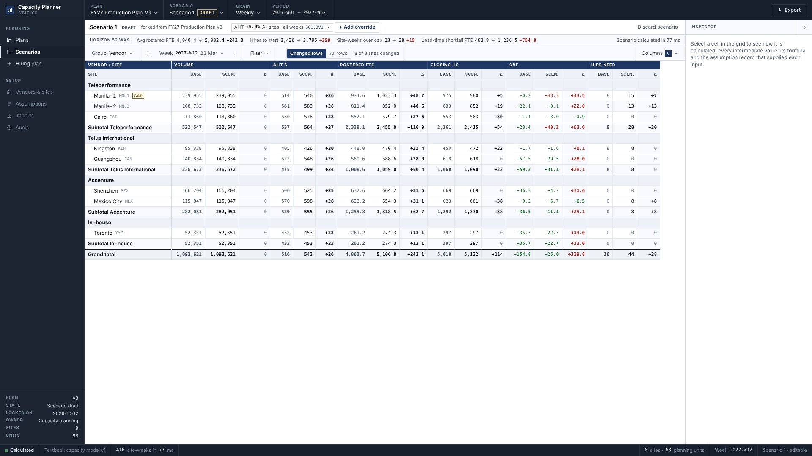
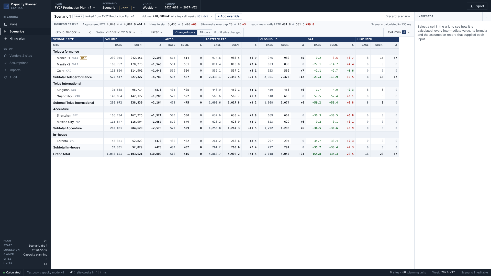
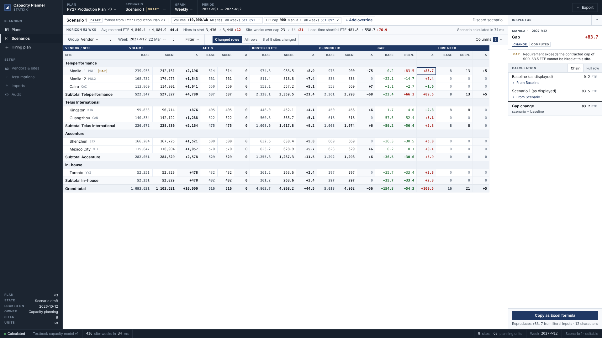
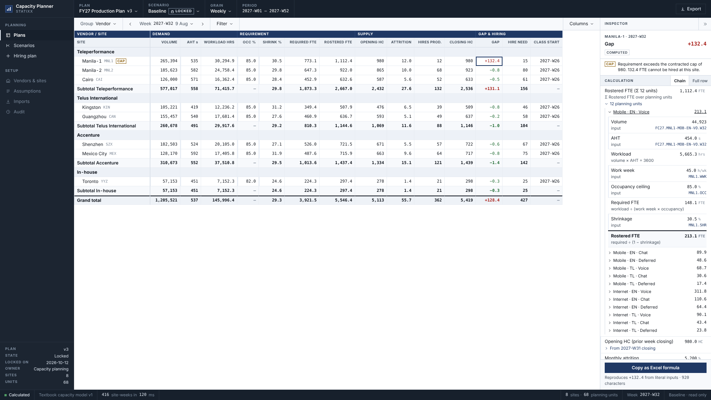
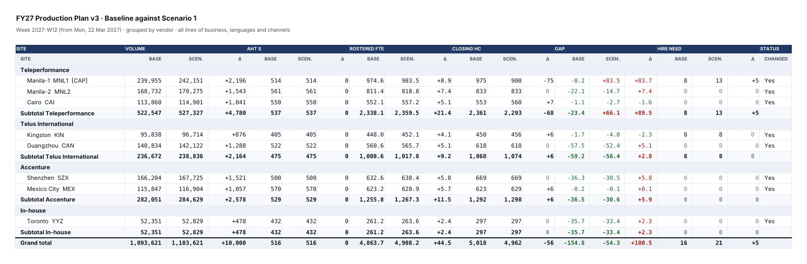

# WFM Capacity Planner (mvp demo)

Multi-vendor contact centre capacity planning. Takes a weekly demand forecast
and produces required headcount per site, the gap against supply after
attrition and ramp, and the recruitment instruction: how many to hire, where,
starting which week.

Statixx Solutions. All data in this repository is invented.

**Click-through demo:** https://isaacxj.github.io/wfm-demo/ (desktop browser,
1600px wide or more)


## Build status

| Phase | Scope | Status |
|---|---|---|
| 1 | Calculation engine and seeded dataset | Done |
| 2 | Plan grid | Done |
| 3 | Calculation inspector | Done |
| 4 | Scenario comparison | Done |
| 5 | Hiring plan view | Done |
| 6 | Excel export | Done |
| 7 | Deploy | Interim: GitHub Pages click-through. Final host to follow |

## Demo walkthrough

Seven steps, following the demo script. Everything runs in the browser on an
invented 2027 dataset: 8 sites, 4 vendors, 68 planning units, 52 weeks.

### 1. Open the locked production plan and read the grid

The app opens on **FY27 Production Plan v3**, scenario **Baseline**, marked
**LOCKED**, at week **2027-W12**. Rows are each vendor, its sites, a subtotal,
then the grand total. Columns run demand → requirement → supply → gap and
hiring. Step through weeks with ‹ ›; filter by line of business, language and
channel; regroup by country. Subtotals add the displayed site values exactly.
Faint left markers show the input cells a planner may change. Manila-1 carries
a **CAP** flag whenever its headcount sits at its contracted cap of 980.

### 2. Move AHT by 5 percent

Open **Scenarios** → **Fork scenario from v3** → **+ Add override** → **AHT**,
+5, all sites, all weeks → **Apply**. Every metric now shows baseline,
scenario and change side by side. In 2027-W12, rostered FTE rises by
**+243.1**. Over the year, hires to start rise from 3,436 to 3,795. The baseline
stays locked; the scenario is a separate, fully recalculated plan.



### 3. Add 10,000 contacts a week and compare side by side

Remove the AHT override (× on its chip), then **+ Add override** → **Volume**,
+10,000 contacts / week → **Apply**. The grand total volume change is exactly
**+10,000**, split across planning units by their share of each week's volume.
Rostered FTE moves **+44.5** in W12. "Changed rows" / "All rows" toggles the
unchanged sites. The strip above the grid summarises the whole year.



### 4. Cut Manila-1 below its requirement

**+ Add override** → **HC cap** → Manila-1 → **900** → **Apply**. Manila-1's
closing headcount drops to the cap and its gap rises by **+83.7**. Selecting the
change cell shows the cap note in the inspector: requirement exceeds the cap,
and the shortfall cannot be hired at this site.



### 5. Read the hiring plan

**Hiring plan** in the rail. This is the recruitment instruction: for each start
week, which site hires how many, training and nesting weeks, the week the class
is productive, and why. 139 classes and 3,436 starters across the year; the
busiest start week is 2027-W25, ahead of the marketing spike. Needs hiring
cannot meet are listed underneath: deficits inside the six-week lead time, and
demand above a contracted cap.


### 6. Trace any number

Select any cell. The inspector shows the chain behind it: every intermediate
value, its formula, and the assumption code of each input. Totals open into
their planning units, and opening headcount into the prior week.
**Copy as Excel formula** copies a formula that reproduces the value. Shown:
Manila-1's gap in 2027-W32, +132.4 FTE above its cap.



### 7. Export to Excel

**Export** (top right) saves the current view as .xlsx, keeping its structure:
merged column-group bands, collapsible vendor groups, live SUBTOTAL formulas
and change formulas. Shown: the comparison from step 4, rendered from the
exported file.



Scenarios are kept in the browser's local storage. **Discard scenario**
returns to a clean start.

## Commands

Node 22.18 or later.

```bash
npm install
npm run dev        # local app
npm run build      # typecheck and static build to dist/
npm test           # engine reference cases, dataset and grid checks
npm run typecheck
npm run totals     # prints dataset totals and the week 12 snapshot
```

## Layout

```
src/engine/   calculation engine; the UI imports src/engine/index.ts only
  requirement.ts  period requirement, channel handling
  erlang.ts       interval staffing, Erlang C with occupancy ceiling
  supply.ts       attrition, roll-forward and hiring primitives
  siteweek.ts     site-week roll-forward with the recommended class fed back
  plan.ts         unit → site → week plan computation
  slice.ts        filtered slice of a site-week, supply allocated by share
  trace.ts        calculation trace with Excel equivalents
  calendar.ts     ISO week arithmetic
src/app/      application shell, plan grid, row model and calculation inspector
src/scenario/ scenarios: overrides applied to a locked plan's inputs
src/export/   .xlsx export of plans, comparisons and the hiring plan
src/testing/  test helpers, never imported by the app
src/data/     seeded demo dataset, 8 sites, 4 vendors, 68 planning units, 52 weeks of 2027
scripts/      totals.ts
```

## Engine

A textbook capacity model behind the `CapacityEngine` interface in
`src/engine/index.ts`. A replacement engine implements the same interface.

- Requirement: workload = volume × AHT ÷ 3600; required = workload ÷ (work week × occupancy); rostered = required ÷ (1 − shrinkage)
- Chat: effective AHT = AHT ÷ (concurrency × efficiency). Deferred work applies no occupancy ceiling
- Interval: Erlang C, always floored at ceil(traffic ÷ occupancy ceiling)
- Supply: weekly attrition = 1 − (1 − monthly)^(1 ÷ 4.33); a contracted cap limits productive hires and surfaces demand above it as a cap shortfall
- Hiring: starters = ceil(deficit ÷ (1 − training attrition)), starting training + nesting weeks before the need. The recommended class lands in supply, so a persisting deficit is hired for once
- Minimum class size: a recommended class has at least 8 starters, rounded up from the need where room under any cap allows; the extra graduates carry forward as a small surplus
- Committed pipeline: classes already in training at plan start land in weeks 1 to 6; inside that lead time no new class can land, and any deficit remains as a lead-time shortfall
- Filters: demand sums over the matching planning units; site supply is allocated to the slice by its share of rostered FTE

Every result carries an ordered trace: label, value, unit, formula, the
assumption record code of each input, and an Excel formula that reproduces the
value from literal inputs. Each computed step lists the steps it was computed
from, and roll-ups carry their sub-chains: a site's demand carries each
planning unit's trace, a week's opening headcount carries the prior week's.

## Plan grid

Opens on the locked FY27 production plan at week 2027-W12. Rows are a vendor
header, its sites and a subtotal, then a grand total; grouping switches to
country or none. The toolbar filters by week, line of business, language and
channel. Under a filter, demand covers only the matching planning units and
site supply is split by share of rostered FTE; the supply band says so.

Subtotals add the site values as displayed, so every summed column reconciles
digit for digit on screen. Input cells carry a left marker; computed cells do
not.

## Calculation inspector

Selecting any cell shows how it was calculated, in the panel on the right:
every intermediate value with its formula, and the assumption record code of
each input. The default view is the chain behind the selected number; "Full
row" shows the whole site-week. Site roll-ups expand into their planning units,
opening headcount into the prior week, subtotals into their sites, and filtered
slices into the site they were split from.

"Copy as Excel formula" puts a self-contained formula on the clipboard that
reproduces the selected value from literal inputs. A site above its contracted
cap, a deficit inside the training lead time, and a filtered split are called
out above the chain. The panel collapses to a narrow strip and remembers its
state; selecting a cell opens it, Escape clears the selection.

## Scenarios

The FY27 production plan is locked. A scenario forks from it and overrides
inputs: weekly volume (contacts per week or a percentage, for a range of weeks),
AHT, shrinkage, monthly attrition, or a site's contracted headcount cap, each
scoped to all sites, a vendor or one site. Added contacts are split across the
planning units in scope by their share of each week's volume. The baseline is
never edited; the scenario is a second plan the engine computes in full, and
each overridden input carries the override's code (for example `SC1.OV2`) in
its assumption record.

The Scenarios view compares the two in one grid: per metric, baseline,
scenario and change. It shows changed rows by default, with a toggle for all
rows, and a horizon strip above it: average rostered FTE, hires to start,
site-weeks over cap and lead-time shortfall, baseline against scenario. A
scenario recalculates in well under a second. Selecting a change cell traces
it as scenario minus baseline, each side opening into its own chain.
Scenarios are kept in the browser's local storage.

## Hiring plan

The recruitment instruction for the open plan or scenario: how many to hire, at
which site, starting which week. Classes are grouped by start week (or by site),
each with its vendor, starters, expected graduates after training attrition, the
training and nesting weeks, the week its graduates are productive, the deficit
it closes and what drives it. A summary line gives classes, starters, graduates,
the first class and the busiest start week. Needs hiring cannot meet are listed
separately with an action: deficits inside the training lead time, and demand
above a contracted cap. Every number is read from the plan, so the instruction
and the grid agree, and any cell opens its site-week chain in the inspector.

## Excel export

Export in the top bar saves the current view as .xlsx: the plan grid for the
selected week (with the hiring plan and the assumption register as further
sheets), a scenario comparison (with its overrides and horizon summary), or
the hiring plan. The workbook keeps the grid's structure: merged column-group
bands, group header rows, site rows, subtotals and a grand total, with Excel
outline levels so each group collapses, and the site column and headers
frozen. Subtotals and totals are SUBTOTAL formulas over site values written at
display precision, and comparison changes are formulas, so the workbook adds
up exactly as the screen does and keeps doing so when edited. A comparison
export includes every row, changed or not. The spreadsheet library (exceljs)
loads on first export only.

## Deployment

Every push to `main` runs `.github/workflows/pages.yml`, which runs the tests,
builds, and publishes `dist/` to GitHub Pages. The build uses relative asset
paths, so the same output also serves from a domain root when the demo moves
to its final host. The page carries `noindex, nofollow`.

One-time setup: repository **Settings → Pages → Build and deployment → Source:
GitHub Actions**.

